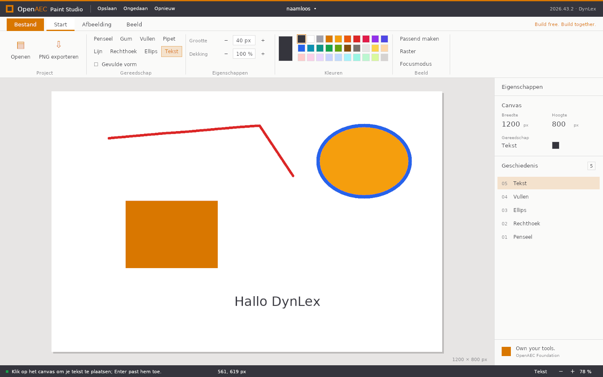

# OpenAEC Paint Studio — native DynLex edition

A port of the editor to [DynLex](https://github.com/OpenAEC-Foundation/dynlex):
one native executable that draws its own OpenAEC shell through the compiler's
Vulkan graphics library, with no browser, WebView, Node.js or Rust involved.



## Build and run

The compiler is a separate DynLex checkout, built in place (`build/dynlex`).

```sh
DYNLEX_ROOT=~/dynlex dynlex/build.sh app          # dynlex/build/open-paint-studio
DYNLEX_ROOT=~/dynlex dynlex/build.sh test         # headless tests
dynlex/build/open-paint-studio [IMAGE.png|.bmp|.ppm]
```

Runtime libraries: Vulkan, GLFW, FreeType, libpng (and zlib); a system font
(DejaVu Sans, else Liberation Sans or Noto Sans); `zenity` for the Open and
Save dialogs.

## What is ported

| Area | Browser editor | Native edition |
|---|---|---|
| Tools | brush, eraser, fill, picker, line, rectangle, ellipse, text, crop | all nine; one stroke paints each pixel once at its opacity, as a canvas path with global alpha does |
| Properties | size, opacity, filled/outline, 30-colour palette | same palette and order |
| Image | crop, resize, rotate left/right, flip horizontal/vertical | same; resize in 50 % / 200 % steps (bilinear) |
| Colour corrections | brightness, contrast, saturation, grayscale, invert, sepia | same formulas as `shared/adjustments.ts`, applied in steps |
| History | 40 undo states, history panel | 40 states; the panel follows undo and redo |
| View | zoom, pan, pixel grid, fit, focus mode | wheel zoom around the cursor, middle-button pan, grid from 600 % |
| Shell | title bar, ribbon tabs, ribbon, properties panel, status bar | same layout; Dutch and English; light, Forge, Blueprint and high-contrast themes |
| Files | PNG, JPEG, WebP, GIF, BMP, TIFF, HEIC, AVIF, PSD, SVG, RAW … via native decoders and ImageMagick WASM; IFCX/IFCXB | PNG (libpng, keeps alpha), BMP 24/32 bit, binary PPM |

Not ported: editable vector objects and SVG export, IFCX/IFCXB documents, the
formats that need ImageMagick, the OpenAEC theme variant, the local draft in
IndexedDB, the HTTP API and the MCP server, installers and signing.

## Size

Measured on 2026-10-31 against the browser editor at `3cb049c`.

| | Browser editor (TypeScript/React/Tauri) | Native edition (DynLex) |
|---|---|---|
| Source of the editor | 105 KB TS/TSX + 54 KB CSS + 4 KB Rust (1,086 dense lines + 877 CSS lines) | 133 KB in 7 `.dl` files (2,521 lines) |
| Additional services | API + MCP: 15 KB | none |
| Tests | 33 KB | 11 KB (3 headless tests) |
| Third-party code at run time | React, Vite build, ImageMagick WASM, Tauri/WebView, fonts | system Vulkan, GLFW, FreeType, libpng |
| Deliverable (Linux) | 8.6 MB `.deb`, 87 MB AppImage | 187 KB executable (`-O2`) |
| Compile | `tsc` + Vite + `cargo` | 2.3 s, 150 MB peak |

DynLex lines are shorter (52 characters on average against 88 for the
TypeScript), so line counts flatter the TypeScript; bytes compare better.

## Layout

| File | Contents |
|---|---|
| `paint/canvas.dl` | RGBA canvas, compositing, strokes, shapes, flood fill, crop/resize/rotate/flip, colour corrections |
| `paint/files.dl` | PNG through libpng's simplified API, BMP and PPM readers and writers |
| `paint/history.dl` | undo/redo snapshots |
| `paint/text.dl` | UTF-8 interface text and the text tool's glyph rendering into the canvas |
| `paint/app.dl` | editor state, tools and every command |
| `paint/ui.dl` | themes, ribbon, panel, status bar, workspace; immediate-mode buttons |
| `paint/main.dl` | window, input, file dialogs, canvas texture |

## Known limits

- The graphics runtime offers only UNORM textures on an sRGB swapchain, so the
  canvas is shown through an eight-bit linear texture: very dark tones band on
  screen. The pixels themselves (and saved files) are unaffected. An sRGB
  texture format in the runtime would remove this.
- Text input reads key presses on a US layout (letters, digits, common
  punctuation); there is no character callback in the runtime yet.
- Mouse coordinates are taken as framebuffer pixels; on a scaled (HiDPI)
  display they need the content scale, which the runtime does not expose.
