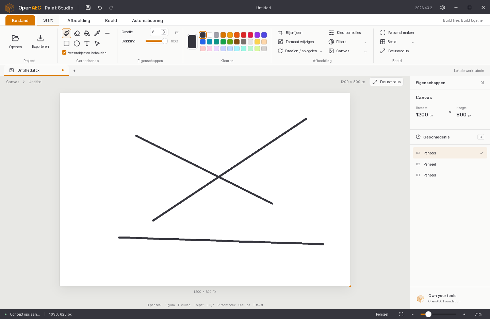
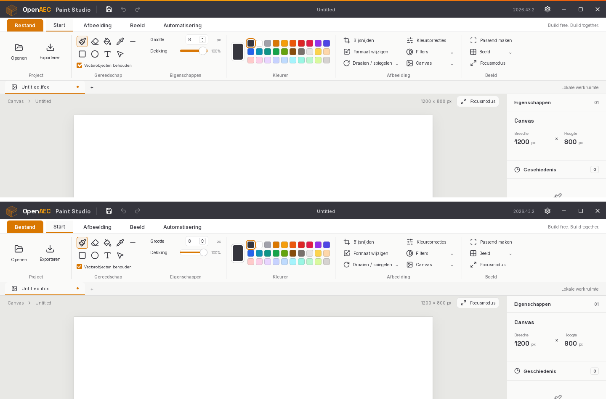

# Open Paint Studio — the native DynLex edition of OpenAEC Paint Studio

One native executable, written in [DynLex](https://github.com/OpenAEC-Foundation/dynlex),
that looks like the browser editor and works like it: no browser, WebView,
Node.js or Rust. The interface is the original's, measured element by element
in WebKitGTK (the engine of the Tauri build) and redrawn with the same fonts,
shaping, icons and sRGB compositing.



Top: the Tauri build. Bottom: Open Paint Studio, same window size.



## Build, run, install

The compiler is a separate DynLex checkout, built in place (`build/dynlex`).

```sh
DYNLEX_ROOT=~/dynlex dynlex/build.sh app          # dynlex/build/open-paint-studio
DYNLEX_ROOT=~/dynlex dynlex/build.sh test         # headless tests
DYNLEX_ROOT=~/dynlex dynlex/build.sh install      # menu entry and icon in ~/.local/share
dynlex/build/open-paint-studio [IMAGE]
```

Runtime libraries: Xlib with MIT-SHM (the window, drawn without a GPU),
FreeType and HarfBuzz (text). Image formats, compression and SVG are the
editor's own code. DejaVu Sans for the text tool and as the fallback face; `zenity` for the file and colour dialogs. The
interface fonts (Inter, Space Grotesk; SIL Open Font License) ship in
`assets/fonts`; the application icon (its own, drawn for this edition) is
`assets/icon/open-paint-studio.svg`, with PNGs from 16 to 512 pixels.

## How the interface is made

1. `tools/shell/measure_webkit.py` loads the built browser editor in WebKitGTK
   with the desktop title bar and runs `tools/shell/measure.js`. That records
   every visible box, text line, icon, image and control: its rectangle and
   computed style, for each ribbon tab, each open menu, the file panel and an
   empty and a filled history, at 1440 × 940, 1200 × 940 and 1440 × 800
   (`tools/shell/measurements/`).
2. `tools/shell/make_skin.py` compares the states and sizes and writes
   `paint/skin_data.dl`: the elements in paint order, each with the condition
   under which it shows and how its rectangle follows the window. Boxes with
   radius, border or shadow, the Lucide icons and the logo become SVG; changing
   text becomes fields (`{name}{ext}`, `{w} × {h} px`, `{zoom}%`, …); clickable
   elements become actions.
3. At run time `paint/shell.dl` draws that skin into a frame on the CPU:
   - SVG through the editor's own rasteriser (`paint/vector.dl`);
   - text through HarfBuzz and FreeType with the browser's hinting and whole-pixel
     advances, from the same WOFF2 files (`paint/typeset.dl`);
   - everything blended in sRGB, as the browser does.

   The canvas is laid out and fitted with the original's formula, and the chrome
   is cached until its state changes. Only what changed is composed again and
   put on the window, through a shared-memory X image (`paint/window.dl`).

Pixels within 8 levels of the Tauri build's screenshot, same window and state:

| | Start | Afbeelding | Beeld | Automatisering | open menu |
|---|---|---|---|---|---|
| frame as composed on the CPU | 98.8 % | | | | |
| on screen, after the GPU upload | 98.8 % | 98.5 % | 98.7 % | 98.6 % | 98.7 % |

The rest are mostly single kerned letter pairs one pixel apart, and the
slider and spin-box approximations of WebKit's native controls. On screen,
about 10 % of the pixels also differ by 1–3 levels. The runtime takes 8-bit
linear values for an sRGB swapchain, so not every sRGB colour is reachable
([dynlex#17](https://github.com/OpenAEC-Foundation/dynlex/issues/17)).

## What it does

| Area | Native edition |
|---|---|
| Tools | brush, eraser, fill, picker, line, rectangle, ellipse, text, select; Bijsnijden crops; Escape cancels what is under way (stroke, shape, text, menu) and selects |
| Window | its own title bar, as the desktop build: drag to move, double click or the button to maximise, minimise, close |
| Ribbon | Bestand and Start, as in the original: every command sits on Start, the view and API commands as small icon buttons beside the Beeld group; the five menus open and close |
| File | the File page of the OpenAEC Blueprint (a 260-pixel page list, the chosen page's action tiles, Settings, Return and Exit): New, Open, Save, Export, Formats, About |
| Dialogs | New canvas (name, size, presets, background), Resize, Colour corrections (three sliders), Settings and API, with focus rings, typing, spin buttons, selects and sliders; Enter applies, Escape closes |
| Properties | size (spin box), opacity (slider), "Vectorobjecten behouden" (off flattens the history to one step, as in the original) |
| Colours | the 30 swatches and, behind the colour well, a full colour picker: saturation and brightness field, hue bar, HEX and R, G, B |
| Image | rotate, flip, double size, grayscale, invert, sepia, clear |
| History | 40 states, each kept as the rectangle its change touched; the history panel lists them as the original does |
| View | the original's fit (whole percents, refit when the workspace changes size), zoom by wheel, buttons and status-bar slider, middle-button pan, grid, focus mode, the properties panel hidden and shown |
| Files | see below; up to 32768 pixels a side and 268 megapixels, kept at full resolution |

Not ported:
- editable vector objects and SVG export, IFCX/IFCXB;
- changing theme or language in Settings: the skin measures the light Dutch interface;
- the API exchange itself (the dialog opens; the HTTP API and MCP server are not ported);
- the HTTP API and the MCP server;
- the local draft;
- installers and signing.

## Files

Every format is read by the editor's own code, recognised by the file's
contents rather than its name:

| Format | Read | Written |
|---|---|---|
| PNG | all bit depths and colour types, palettes, transparency, Adam7 (`paint/png.dl`, deflate in `paint/inflate.dl`) | 8-bit RGBA |
| JPEG | baseline, extended and progressive; grey, YCbCr, CMYK, YCCK; restart intervals; EXIF orientation (`paint/jpeg.dl`, decoded over all cores) | baseline 4:2:0, quality 90 |
| GIF | first frame, transparency, interlacing (`paint/formats.dl`) | — |
| BMP | 24 and 32 bit | 24 bit |
| TIFF | strips; none, LZW, deflate, PackBits; 1/8/16 bit, palettes | — |
| TGA, ICO, QOI, PNM (P1–P6), XBM, XPM | `paint/formats.dl` | PPM |
| SVG, SVGZ | paths, shapes, strokes, transforms, clip paths, blur (`paint/vector.dl`); no text | — |

Not read: WebP, AVIF, HEIC, JPEG XL, JPEG 2000, DDS, lossless and
arithmetic-coded JPEG.

`tests/images/make_test_images.py` writes a test set:
- 52 variants of one test card (bit depths, palettes, alpha, interlacing, compression, EXIF orientation, misnamed files);
- 30 images from `/usr/share`;
- 5 broken files.

`bench/open_images.dl` opens them all and `tests/images/compare.py` checks
each against an independent decoder (Pillow or gdk-pixbuf). State on
2026-10-31, after the move to the editor's own decoders:
- PNG and JPEG (all 27 variants, from 97 × 61 to 4K) match: PNG exactly, JPEG
  within the lossy tolerance;
- still to finish: palette and 1-bit BMP, XBM, uncompressed TGA (taken for an
  ICO), TGA run-length colours, XPM colour names, and SVG fidelity (the
  Ubuntu logos and the test card's text differ);
- the formats listed as not read report that, and broken files fail with a
  readable message.

## The interface, tested in all three editions

`tests/ui/run_ui_test.py` runs 112 steps through the web edition (in a
WebKitGTK window), the Tauri build and Open Paint Studio with real mouse and
keyboard input:
- every tool by button and by key, drawing with each;
- swatches, size and opacity;
- undo and redo by button and keys;
- text, and Escape while typing, mid-stroke, in a menu and in the file panel;
- all menu items, the ribbon buttons, the three tabs and the status bar;
- the view shortcuts, the file dialogs, the window buttons.

It saves a screenshot per step and writes a report comparing each step with
the Tauri build (`build/ui-test/report.md`).

Result on 2026-10-31:
- **Web and Tauri:** identical at every step except the file dialogs, which
  differ between browser and desktop by design.
- **Open Paint Studio:** follows both through the tools, drawing, swatches,
  properties, undo and redo, the menus, the filters and the tabs, within
  1–5 % of pixels.

Where it differs, it is in what is not ported:
- editable vector objects (Delete removes a selected object in the original);
- the original's text box with its Klaar/Annuleren buttons;
- the original folding the history into one "Afbeelding" step after a raster
  operation;
- the focus ring on fields.

## Compared with the Tauri build and the Rust edition

Measured on 2026-10-31 on the same machine (Ryzen 7 9700X), on Xvfb. The Rust
edition is the native port on the `rust/native-port` branch.

**Start and footprint** (`bench/startup.py`, `bench/first_frame.py`)

| | Tauri build | Rust edition | Open Paint Studio |
|---|---|---|---|
| window drawn after start | 1.05–1.19 s | 29 ms | 48 ms |
| processes | 3 | 1 | 1 |
| memory, whole process tree (PSS) | 237 MB | 38 MB | 24 MB |
| idle CPU after start-up | 0.1 % | 0.0 % | 0.0 % |
| CPU per mouse move / per brush-drag event | — | 1.2 / 4.1 ms | 0.07 / 0.14 ms |

The DynLex edition drew its first frame in 28 ms while librsvg drew the
interface's icons; its own SVG rasteriser takes the difference.

**Large images** (`bench/make_large_images.py`, a real 4K photograph scaled
up). For Tauri: the editor's own `decodeFile` path (`src/images.ts`) run
verbatim in WebKitGTK by `bench/webkit_decode.py`. For Open Paint Studio:
`bench/large.dl`; for Rust its `large` example. Decoding is until the pixels
are ready to edit; redraw is one frame at a new zoom level.

| image | Tauri: decode / first frame / redraw | Rust: decode / first frame / redraw, peak | Open Paint Studio: decode / first frame / redraw, peak |
|---|---|---|---|
| 4K JPEG, 8.3 MP | 1861 / 180 / 32 ms | 47 / 8 / 5 ms, 123 MB | 36 / 6 / 4 ms, 70 MB |
| 4K PNG | 2073 / 192 / 32 ms | 90 / 8 / 5 ms, 123 MB | 196 / 6 / 4 ms, 91 MB |
| 8K JPEG, 33 MP | 2220 / 178 / 32 ms (kept at 8.4 MP) | 128 / 8 / 6 ms, 317 MB | 118 / 6 / 4 ms, 206 MB |
| 8K PNG | 2577 / 174 / 32 ms (kept at 8.4 MP) | 314 / 8 / 6 ms, 317 MB | 775 / 7 / 4 ms, 281 MB |
| 16K JPEG, 133 MP | refused: more than 64 megapixels | 439 / 8 / 6 ms, 1.10 GB | 428 / 7 / 4 ms, 0.75 GB |
| 16384² JPEG, 268 MP | refused | 831 / 8 / 6 ms, 2.16 GB | 751 / 7 / 4 ms, 1.49 GB |

The JPEG decoder runs the inverse DCT and colour conversion over all cores;
the PNG inflater is single-threaded and still slower than libpng (107 and
419 ms with it). The canvas is sampled at screen resolution over all cores,
so redraws stay at 4 ms however large the image.

**Code** (the browser editor at `3cb049c`)

| | Tauri build | Open Paint Studio |
|---|---|---|
| interface and logic | 1,554 lines, 134 KB (TypeScript/TSX, CSS, shared, Rust) plus React, Vite and ImageMagick WASM | 9,308 lines, 506 KB of DynLex, including its own raster engine, typesetter, compositor, image codecs, deflate and SVG rasteriser |
| interface layout | in the CSS | `paint/skin_data.dl`, 179 KB generated from the measurements |
| tools for the layout | — | 686 lines of Python and JavaScript |
| services | HTTP API and MCP, 193 lines | none |

The DynLex lines are short (52 characters on average, against 88 in the TypeScript).

## Layout

| File | Contents |
|---|---|
| `paint/canvas.dl` | RGBA canvas, compositing, strokes, shapes, flood fill, crop/resize/rotate/flip, colour corrections |
| `paint/files.dl` | opening by content and saving by extension; BMP and PPM |
| `paint/png.dl`, `paint/jpeg.dl`, `paint/formats.dl` | the image codecs |
| `paint/inflate.dl` | deflate, zlib and gzip, both ways |
| `paint/window.dl` | the X11 window, input and shared-memory presentation |
| `paint/history.dl` | undo/redo states, shrunk to the changed rectangle |
| `paint/app.dl` | editor state, tools and commands |
| `paint/text.dl` | the text tool's glyph rendering into the canvas |
| `paint/typeset.dl` | the interface's text: HarfBuzz shaping, FreeType glyphs, sRGB blending |
| `paint/vector.dl` | SVG to pixels |
| `paint/skin.dl` | skin entries, conditions and geometry |
| `paint/skin_data.dl` | the measured interface (generated) |
| `paint/shell.dl` | the compositor: skin, fields, controls, canvas, history rows, menus, click actions |
| `paint/main.dl` | input handling, dialogs, event loop |
| `tools/shell/` | measuring the browser editor and generating the skin |
| `bench/` | speed and memory measurements against the Tauri build |
| `docs/lessons.md` | what this port taught |

## Known limits

- **Window system:** X11 (XWayland on a Wayland desktop). The window class
  matches the menu entry that `build.sh install` adds, so the dock shows the
  icon.
- **Window width:** the skin is linear between 1000 and 1600 pixels of width. The
  original's CSS changes layout below 1000 and above 1600.
- **Text input:** reads key presses on a US layout. The runtime has no
  character callback.
