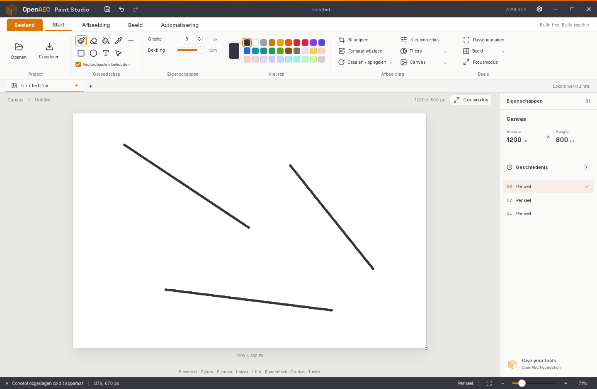

# Open Paint Studio — the native Rust edition of OpenAEC Paint Studio

One native executable, written in Rust, that looks like the browser editor and
works like it: no browser, WebView, Node.js or Tauri. It is the third
edition of the same tool, beside the Tauri build (`main`) and the DynLex
edition (`dynlex/native-port`), with the same scope as the DynLex edition so
the three can be compared. Like the DynLex edition, the interface is the
original's, measured element by element in WebKitGTK (the engine of the Tauri
build) and redrawn on the processor with the same fonts, shaping, icons and
sRGB compositing.



## Build, run, test

Built with Rust 1.99.1 (stable); older toolchains not tried.

```sh
cd rust
cargo build --release                 # target/release/open-paint-studio
target/release/open-paint-studio [IMAGE]
cargo test --release                  # raster engine, history, files
```

Runtime: an X display (XWayland on a Wayland desktop); FreeType, HarfBuzz,
gdk-pixbuf, librsvg and cairo (all part of every GNOME desktop, the same
libraries the DynLex edition uses; the Tauri build needs them too, through
WebKitGTK); DejaVu Sans for the text tool and as the
interface's fallback face, and `zenity` for the file and colour dialogs. The
interface fonts (Inter, Space Grotesk; SIL Open Font License) and the icon are
compiled into the executable. `assets/open-paint-studio.desktop` is the menu
entry; the window's WM_CLASS is `open-paint-studio`.

### Crates

| Crate | For |
|---|---|
| [`x11rb`](https://crates.io/crates/x11rb) 0.13 | the window, input and presenting, over the X11 protocol itself (its pure-Rust connection, no Xlib) |
| [`freetype-rs`](https://crates.io/crates/freetype-rs) 0.38 | glyphs, hinted as WebKitGTK hints them; HarfBuzz is called directly (11 declarations in `src/typeset.rs`) for shaping with hinted advances (`hb_ft`) |
| [`png`](https://crates.io/crates/png) 0.18 | build only: `build.rs` decodes the window icon, so starting needs no image decoder |

10 crates in the program, dependencies included. The system's gdk-pixbuf
(image files), librsvg and cairo (SVG) are called directly, as the DynLex
edition calls them (`src/files.rs`, `src/vector.rs`); see "Program size"
for why. A first try used `winit` and
`softbuffer`; winit's X11 backend needs `libxkbcommon-x11`, which this
machine does not have, so the window went to `x11rb` and became smaller.

## How the interface is made

The same three steps as the DynLex edition, with its measurement tools reused:

1. `tools/measure_webkit.py` and `tools/measure.js` (from
   `dynlex/tools/shell/`) load the built web editor in WebKitGTK and record
   every visible box, text line, icon and control with its rectangle and
   computed style, per ribbon tab, open menu, file panel and an empty and a
   filled history, at 1440 × 940, 1200 × 940 and 1440 × 800
   (`tools/measurements/`, measured again at `3cb049c`, which has the
   Afbeelding tab).
2. `tools/make_skin.py` (from `dynlex/tools/shell/make_skin.py`) compares the
   states and sizes and now writes Rust: `src/skin_data.rs`, 654 elements in
   paint order with the condition under which each shows and how its rectangle
   follows the window, and 156 SVG images.
3. `src/shell.rs` draws that skin into a frame on the processor: SVG through
   librsvg and cairo, text through HarfBuzz and FreeType, everything blended in sRGB. The
   chrome is cached until its state changes; the window receives only the rows
   of the frame that changed.

Reused from the DynLex edition: `measure_webkit.py`, `measure.js`,
`make_skin.py` and `startup.py` and `make_large_images.py` from `bench/`, and
the large test images they make. Changed on the way, each a measured gain:

- **Measure with a fresh profile.** WebKitGTK takes the desktop's GNOME font
  settings (slight hinting here); the Tauri build in the comparison runs with
  an empty profile and hints fully. Measured with the desktop's settings,
  every text came out narrower.
- **Snap half pixels up.** `make_skin.py` rounded boxes with Python's
  `round()`, which takes 6.5 to 6; WebKit snaps it to 7. Icons and boxes at
  half pixels moved one pixel.
- **Quarter-pixel glyph positions.** WebKitGTK 2.52 draws through Skia, which
  places glyphs at quarter pixels: a label at x = 68.6 is drawn half a pixel
  over, its stems spread over two columns. `src/typeset.rs` renders each glyph
  hinted and then shifted by its quarter (FreeType applies the shift after
  hinting). From 98.8 % to 99.3 % on the Start tab.
- **Border images.** The title bar's amber line is a CSS `border-image`
  gradient, which `measure.js` did not record; it does now, and
  `make_skin.py` turns it into SVG. Three rows across the window.
- **Wrapped centred text** is centred in its element, not after its first
  line's start.
- **The filled history is measured after the local draft is saved**, so the
  status bar is measured at rest.

`tools/compare_tauri.py` starts the Tauri build and this edition fresh on an
X display, clicks through the same states with XTEST and counts the pixels
within 8 levels (every channel) of the Tauri build's screenshot, same window
(1440 × 940) and state:

| | Start | Afbeelding | Beeld | Automatisering | menu 0 | menu 1 | menu 2 | menu 3 | menu 4 | file panel | three strokes |
|---|---|---|---|---|---|---|---|---|---|---|---|
| on screen | 99.7 % | 99.4 % | 99.4 % | 99.4 % | 99.6 % | 99.6 % | 99.7 % | 99.4 % | 99.6 % | 99.7 % | 99.5 % |

The menus are the five drop-downs of the Start tab (Exporteren, Draaien /
spiegelen, Filters, Canvas, Beeld). The rest is mostly the anti-aliasing of
the icons' curves (librsvg and cairo against Skia; resvg gave the same
figures within 0.1 %) and the approximations of WebKit's
native slider and spin box. The frame goes to the window as it is composed,
so what is on screen is the composed frame.

For comparison, the DynLex edition reports 98.5–98.8 % on screen for Start,
Afbeelding, Beeld, Automatisering and an open menu.

## What it does

The same as the DynLex edition:

| Area | Rust edition |
|---|---|
| Tools | brush, eraser, fill, picker, line, rectangle, ellipse, text; Bijsnijden crops |
| Ribbon | Start, Afbeelding, Beeld, Automatisering as in the original; the five menus and the file panel open and close |
| Properties | size (spin box), opacity (slider), the 30 colours, a colour dialog behind the colour well |
| Image | rotate, flip, double size, grayscale, invert, sepia, contrast, clear |
| History | 40 states, each kept as the rectangle its change touched; the history panel lists them as the original does |
| View | the original's fit (whole percents, refit when the workspace changes size), zoom by wheel, buttons and status-bar slider, middle-button pan, grid, focus mode |
| Files | see below; up to 32768 pixels a side and 268 megapixels, kept at full resolution |

Keys: B brush, E eraser, F fill, I picker, L line, R rectangle, O ellipse,
T text, C crop, G grid; Ctrl+Z / Ctrl+Shift+Z / Ctrl+Y, Ctrl+S, Ctrl+Shift+S,
Ctrl+O, Ctrl+N; + and − zoom, 0 fits, Delete clears, Escape cancels. Text
input follows the keyboard layout of the X server.

Not ported (as in the DynLex edition):
- editable vector objects and SVG export, IFCX/IFCXB;
- the dialogs (new canvas, resize, settings, colour corrections);
- the HTTP API and the MCP server;
- the themes and the English interface: the skin measures the light Dutch interface;
- the local draft;
- installers and signing.

## Files

Through the system's gdk-pixbuf, as in the DynLex edition: PNG, JPEG, GIF,
BMP, TIFF, ICO, PNM, TGA, QOI, XPM, XBM, JPEG 2000 and, through its
installed loaders, WebP, AVIF, HEIC, JPEG XL and SVG; EXIF orientation
applied. On this machine (Ubuntu 26.04, gdk-pixbuf 2.44) gdk-pixbuf decodes
in glycin's sandboxed loader processes, which start when the first file is
opened. `examples/open_images.rs` opens the DynLex edition's test set
(`dynlex/tests/images/make_test_images.py`): 81 of the 82 valid images open,
DDS is reported as unsupported (as in the DynLex edition), and the five
broken files fail with a readable message.

Saved: PNG, JPEG, WebP, AVIF, BMP, TIFF, ICO through gdk-pixbuf, and PPM
written here, by the extension; PNG when there is none.

## Program size

The first version was 5.3 MB, eight times the DynLex edition's 0.65 MB. By
symbol, the image codecs of the `image` crate were about 2.1 MB (OpenEXR
alone 0.6 MB, then JPEG, WebP, TIFF, PNG and deflate), the SVG renderer
(resvg, usvg, tiny-skia) 0.6 MB, Rust's standard library 0.6 MB, and the
editor itself 0.11 MB with 0.45 MB of generated interface. The DynLex edition
has none of the codecs or the SVG renderer in its program: it calls the
system's gdk-pixbuf, librsvg and cairo. Measured step by step:

| | program |
|---|---|
| `image` + resvg, `opt-level = 3`, thin LTO (first version) | 5.25 MB |
| the same, fat LTO, one codegen unit | 4.68 MB |
| the same, `opt-level = "z"` (smallest, slower) | 3.82 MB |
| gdk-pixbuf, librsvg and cairo from the system instead, thin LTO, stripped | 995 KB |
| + fat LTO, one codegen unit | 931 KB |
| + the window icon decoded at build time (raw RGBA, +13 KB) | **944 KB** |

`opt-level = "s"` would save another 66 KB and slow the pixel loops, so the
program keeps `opt-level = 3`. What is left: the generated interface (SVG
markup, 654 entries and their relocations) about 0.4 MB, Rust's standard
library about 0.25 MB (its panic and backtrace code included), the editor
0.11 MB, the fonts 85 KB, x11rb 67 KB.

What the change costs and brings, measured:
- **Pixels:** the same within 0.1 % (one menu 99.7 → 99.6 %).
- **Start:** unchanged (one process, window drawn in 0.07–0.13 s, 37 MB
  instead of 35 MB). Decoding the window icon through gdk-pixbuf would have
  started glycin's three sandbox processes on every start; `build.rs`
  decodes it instead.
- **Decoding** is 20–50 % slower: glycin decodes in a separate, sandboxed
  process (with the same `image` crate) and hands the pixels over. Still
  faster than the DynLex edition, which goes through the same gdk-pixbuf for
  JPEG.
- **Formats:** AVIF, HEIC, JPEG XL, JPEG 2000, XPM and XBM open now; OpenEXR,
  Radiance HDR, DDS and farbfeld no longer do.
- **Build:** 6.4–6.8 s clean instead of 14 s (10 crates instead of 88).

## Compared with the Tauri build and the DynLex edition

Measured on 2026-10-31 on the same machine (16 cores), with
`bench/startup.py` and `examples/large.rs`, the same steps as the DynLex
edition's `bench/startup.py` and `bench/large.dl`, on an Xvfb display. The
Tauri and DynLex columns are the figures from `dynlex/README.md`; the last
rows are all three again, side by side in this session.

**Start and footprint** (`bench/startup.py`)

| | Tauri build | DynLex edition | Rust edition |
|---|---|---|---|
| window fully drawn after start | 1.05–1.19 s | 0.20 s | 0.07–0.13 s |
| processes | 3 | 1 | 1 |
| memory, whole process tree (PSS) | 237 MB | 98 MB | 37 MB |
| idle CPU after start-up | 0.1 % | 0.4 % | 0.0 % |
| program | 19 MB + 16 MB web build + WebKitGTK (122 MB of libraries) | 0.65 MB + 108 KB fonts | 0.94 MB, fonts and icon included |
| this session, same display, three runs | drawn 1.05–1.13 s, 180–233 MB, 0.2–0.4 % idle | drawn 0.18 s, 114–125 MB, 2.6–2.8 % idle | drawn 0.13 s, 35 MB, 0.0 % idle (first version, 5.3 MB) |

The DynLex binary in the last row is the current build in the
`dynlex/native-port` checkout, not necessarily the one its README measured.
A DynLex compile of another project was running on one core during those
runs.

**Large images** (`bench/make_large_images.py`, a real 4K photograph scaled
up; `cargo run --release --example large IMAGE`). Decoding is until the pixels
are ready to edit; redraw is one frame at a new zoom level. Medians of three
runs.

| image | Tauri: decode / first frame / redraw | DynLex: decode / first frame / redraw | DynLex peak | Rust: decode / first frame / redraw | kept as | Rust peak |
|---|---|---|---|---|---|---|
| 4K JPEG, 8.3 MP | 1861 / 180 / 32 ms | 71 / 11 / 8 ms | 116 MB | 47 / 7 / 5 ms | 3840 × 2160 | 123 MB |
| 4K PNG | 2073 / 192 / 32 ms | 120 / 10 / 8 ms | 117 MB | 90 / 8 / 5 ms | 3840 × 2160 | 123 MB |
| 8K JPEG, 33 MP | 2220 / 178 / 32 ms | 201 / 13 / 10 ms | 317 MB | 133 / 9 / 6 ms | 7680 × 4320 | 317 MB |
| 8K PNG | 2577 / 174 / 32 ms | 469 / 10 / 8 ms | 312 MB | 314 / 8 / 6 ms | 7680 × 4320 | 317 MB |
| 16K JPEG, 133 MP | refused | 742 / 14 / 10 ms | 1.1 GB | 469 / 9 / 6 ms | 15360 × 8640 | 1.09 GB |
| 16384² JPEG, 268 MP | refused | 1318 / 13 / 8 ms | 2.2 GB | 922 / 9 / 6 ms | 16384 × 16384 | 2.16 GB |

With the first version's in-process decoders (`image` crate): 31, 70, 103,
273, 389 and 756 ms to decode, 107 MB to 2.14 GB at the peak. Peak memory is
the maximum resident size; sampling the whole process tree, glycin's loader
included, gives the same within 2 %.

The Tauri build keeps at most 8.4 megapixels (3861 × 2172 for the 8K images)
and refuses more than 64 (see `dynlex/README.md`). The Rust edition keeps every
image at full size, one copy to show and one as the stroke's base, as the
DynLex edition does.

**Build** (release, dependencies already downloaded)

| | Tauri build | Rust edition |
|---|---|---|
| clean build | 75.6 s (Rust) + 2.3 s (Vite) | 6.4–6.8 s (10 crates; first version 13.8–14.6 s, 88 crates) |
| after changing one source file | 21.7 s | 3.5–3.8 s (first version 5.3–6.6 s) |
| peak memory of a clean build | | 0.43 GB |

"After changing one source file": a touched file, and a one-line edit (in
`src-tauri/src/lib.rs` for Tauri, `src/shell.rs` here). The release profile
uses fat LTO in one codegen unit, which is most of the incremental time. Between two and six
DynLex compiles of other projects (one core each) were running during these
builds.
The DynLex edition's compile time is not measured here (one DynLex compiler
per machine; other sessions were using it).

**Binary** — `target/release/open-paint-studio`: 944 KB, stripped, fonts and
icon included (see "Program size"). It links FreeType, HarfBuzz, gdk-pixbuf,
librsvg, cairo, GLib and the C library.

**Code** (the browser editor at `3cb049c`: 1,554 lines, 134 KB)

| | Rust edition |
|---|---|
| interface and logic | 2,981 lines, 120 KB of Rust (`src/` without `skin_data.rs`), including its own raster engine, typesetter and compositor |
| interface layout | `src/skin_data.rs`, 821 lines, 254 KB generated from the measurements |
| tools for the layout | 842 lines of Python and JavaScript, 724 of them reused from the DynLex edition |
| tests, benchmarks, build script | 179 lines |

## How long it took

| | |
|---|---|
| session | `2239b498-b6d9-4660-a95d-511add8280b4` (Claude Code) |
| model | Claude Opus 5.5 (`claude-opus-5-5`), no subagents |
| wall clock, first version | 53 minutes: 15:00–15:53 CET on 31 October 2026, from reading the DynLex edition to this README, measurements and the Tauri reference builds included |
| tokens, first version | 254 input, 146,487 output, 336,920 cache creation, 34,285,089 cache read (34.8 million in all) over 126 model calls, counted from the session transcript up to the commit |
| program size (second round) | 8 minutes: 16:26–16:34 CET, from the maintainer's question to the commit; 44 input, 28,003 output, 34,916 cache creation, 8,495,369 cache read (8.6 million in all) over 21 model calls up to the README |

Started from the DynLex edition's README, measurement tools and source (read,
not copied: the Rust code is a port of its structure), with the browser
editor at `3cb049c` as the reference.

## Layout

| File | Contents |
|---|---|
| `src/canvas.rs` | RGBA canvas, compositing, strokes, shapes, flood fill, crop/resize/rotate/flip, colour corrections |
| `src/history.rs` | undo/redo states, shrunk to the changed rectangle |
| `src/files.rs` | opening and saving through gdk-pixbuf; PPM |
| `src/app.rs` | editor state, tools and commands |
| `src/typeset.rs` | HarfBuzz shaping, FreeType glyphs at quarter pixels, sRGB blending; the text tool |
| `src/vector.rs` | SVG to pixels through librsvg and cairo |
| `src/skin.rs` | skin entries, conditions and geometry |
| `src/skin_data.rs` | the measured interface (generated) |
| `src/shell.rs` | the compositor: skin, fields, controls, canvas, history rows, menus, click actions |
| `src/window.rs` | the X11 window: events, presenting changed rows, moving, maximising |
| `src/main.rs` | input, dialogs, the event loop |
| `tools/` | measuring the browser editor, generating the skin, comparing with the Tauri build |
| `bench/`, `examples/` | start-up, large-image and test-set measurements |

## Known limits

- **X11 only.** On a Wayland desktop it runs through XWayland; a session
  without XWayland cannot show it.
- **Window width:** the skin is linear between 1000 and 1600 pixels of width,
  as in the DynLex edition. The original's CSS changes layout outside that range.
- **Fonts as on a fresh profile:** the interface hints fully, as the Tauri
  build does with an empty profile; with the desktop's slight hinting the
  Tauri build's text is narrower.
- **Dialogs** block the window while open (zenity), as in the DynLex edition.
